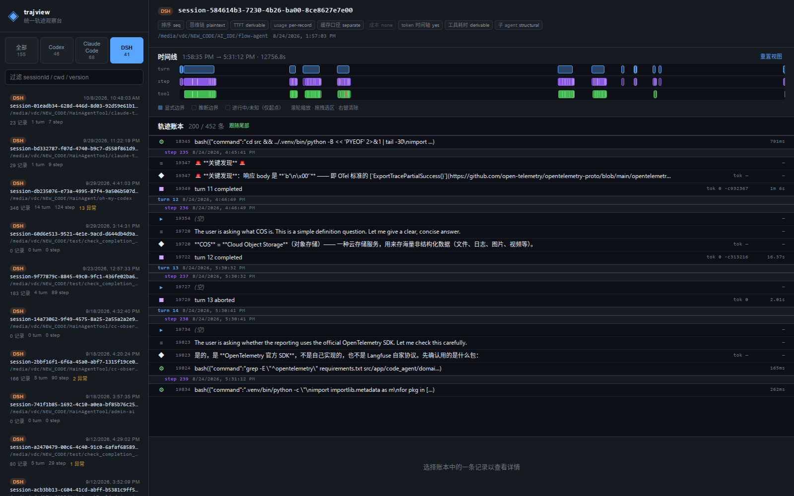

# trajview — 统一 Agent 轨迹观察台

按 DeepSeek Harness `ui-trajectory` 的范式（**turn-aware 轨迹账本 + 时间线总览 + 记录检查器**），
用同一套界面显示 **DeepSeek Harness / Codex CLI / Claude Code** 三源轨迹。



---

## 快速开始

```bash
npm install

# 1) 摄入本机三源轨迹（只读来源，写入 ./data）
npm run ingest

# 2) 构建前端并启动
npm run build:web
npm start                 # http://127.0.0.1:5178
```

`npm run ingest -- --help` 可查看全部参数。

## 三源与各自的权威序

账本排序**永远不用 timestamp** —— 每个源用自己可靠的顺序，否则会静默错乱：

| 源 | 来源位置 | 权威序 | 思维链 | 备注 |
|---|---|---|---|---|
| **Codex** | `~/.codex/sessions/YYYY/MM/DD/rollout-*.jsonl`<br>`~/.codex/archived_sessions/` | `ordinal`（**仅 codex ≥ 0.147.0**）<br>旧版本回退物理行序 | **加密**（只显示字节数） | 双层结构 `response_item` + `event_msg`，两层都必须消费 |
| **Claude Code** | `~/.claude/projects/<cwd-slug>/*.jsonl` | **物理行序** | **明文** | `cost-state` 是周期快照，只取最后一条 |
| **DSH** | `~/.dsh/sessions/--<projectKey>--/<id>/session.jsonl.zstd` | `seq` | **明文** | zstd **帧串联**，需逐帧扫描；`turn/step` 边界是显式的 |

能力差异在界面上以**能力矩阵**如实展示，不假装齐备。未知就是「—」，不会显示 0 或凭空补一个时长。

> 当 Codex 被 **DSH 驱动**（而非自主运行）时，Codex 侧不落盘（`thread/start` 强制 `ephemeral:true`），
> 只能看到 DSH 事件流。界面不会把这叫「降级」——那是**不同的观测面**：DSH 有 token 级时间轴、
> 结构化子 agent 图、显式 turn/step 边界；Codex 侧有自己的原始 item 顺序与专属字段。

## 只读保证

工具**从不写入** `~/.codex`、`~/.claude`、`~/.dsh`。

由于正在运行的 agent 会持续往自己的日志里追加，整棵目录的指纹天然会变化，所以只读性由
**确定性夹具测试**证明（`tests/readonly.test.ts`）：把冻结的夹具喂给真实适配器，逐字节比对来源树。

```bash
npm test -- readonly
```

CLI 里的 `source-tree fingerprint` 仅供参考。

## 数据分层

```
data/
├── vault/            # 原始层：摄入时写时复制（不可变，可整体删除重建）
│   └── <source>/<sessionId>/{session.jsonl[.zstd], meta.json}
├── blobs/            # 大 payload，内容寻址（sha256 分桶）
└── traces.sqlite3    # 派生层：可随时删除并从 vault 重建
```

派生层包含 `sessions / turns / steps / records` 公共脊与 FTS5 全文索引。

> **与 PRD §6.4 的已知偏离**：PRD 原定「公共脊 + 每源 `record_detail_*` 表 + `usage_events` 表」。
> 实现改为把各源原始 payload 以 TEXT 存在脊行的 `detail_text`（超过 16 KiB 转 blob）。
> 迁移规避目标同样达成（新源只是多一份不透明 TEXT，脊不变），但省掉了三张表和随之而来的
> 每次按源查询的额外 join。详见 `src/store.ts` 的 `migrate()` 注释。

```bash
rm -rf data/traces.sqlite3 data/blobs && npm run ingest   # 幂等重建
```

摄入时会跳过来源未变化的会话；改了解析器后用 `--force` 强制重建派生层。

## 命令

| 命令 | 作用 |
|---|---|
| `npm run ingest` | 发现 → 稳定读 → vault → 归一 → 入库 |
| `npm start` | 启动 HTTP 服务并托管已构建的前端 |
| `npm run dev:web` | Vite 开发服务器（代理 `/api` 到 5178） |
| `npm run build:web` | 构建前端到 `web/dist` |
| `npm test` | Vitest 全量测试 |
| `npm run typecheck` | `tsc --noEmit` |

`ingest` 参数：`--data-dir` `--sources codex,claude-code,dsh` `--limit N` `--no-vault` `--force` `--copy-strategy full-copy|incremental-append`

## 抗撕裂读取

来源文件由另一个进程持续追加，因此读取走三步：

1. `stat → read → stat`，身份元组 `[dev, ino, size, mtimeMs, ctimeMs]` 一致才接受
2. 不一致则重试一次；仍不一致就**只取已提交前缀**
3. 末尾没有 `\n` 的半行**不会被当成完整行**交给解析器

DSH 的 zstd 同理：逐帧解析帧头与块头定位边界，末尾半帧只取已提交部分，中间损坏帧跳过并记录，不让整个会话失败。

## 技术栈

TypeScript · Node ≥ 22.15 · React 18 · Vite · Vitest · pnpm/npm

**零原生依赖**：SQLite 用内置 `node:sqlite`（含 FTS5），zstd 用内置 `node:zlib`。

## 上游依据

- `.omx/plans/prd-trajectory-observer-tool.md` —— 架构 PRD
- `.omx/specs/test-spec-trajectory-observer-tool.md` —— 测试规格
- `.omx/plans/feasibility-codex-deepseek-trajectory-observability.md` —— 可行性报告与 R1–R7 修订
- `trajectory-data-sources.md` —— 格式事实源（本工具不修改它）
