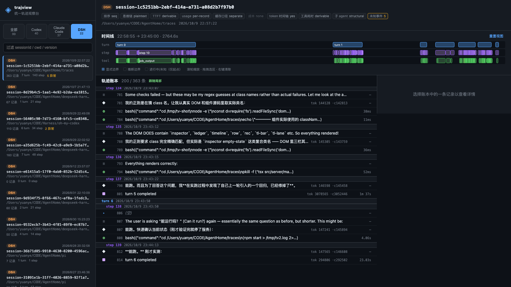
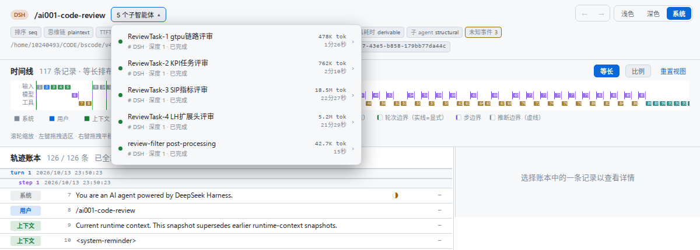

# trajview — 统一 Agent 轨迹观察台

按 DeepSeek Harness `ui-trajectory` 的范式（**turn-aware 轨迹账本 + 时间线总览 + 记录检查器**），
用同一套界面显示 **DeepSeek Harness / Codex CLI / Claude Code** 三源轨迹。




---

## 快速开始

```bash
npm install

# 1) 摄入本机三源轨迹（只读来源，写入 ./data）
npm run ingest

# 2) 构建前端并启动
npm run build:web
npm start                 # http://127.0.0.1:5178
```

`npm run ingest -- --help` 可查看全部参数。

## 三源与各自的权威序

账本排序**永远不用 timestamp** —— 每个源用自己可靠的顺序，否则会静默错乱：

| 源 | 来源位置 | 权威序 | 思维链 | 备注 |
|---|---|---|---|---|
| **Codex** | `~/.codex/sessions/YYYY/MM/DD/rollout-*.jsonl`<br>`~/.codex/archived_sessions/` | `ordinal`（**仅 codex ≥ 0.147.0**）<br>旧版本回退物理行序 | **加密**（只显示字节数） | 双层结构 `response_item` + `event_msg`，两层都必须消费 |
| **Claude Code** | `~/.claude/projects/<cwd-slug>/*.jsonl`<br>`…/<session>/subagents/agent-*.jsonl` | **物理行序** | **明文** | `cost-state` 是周期快照，只取最后一条 |
| **DSH** | `~/.dsh/sessions/--<projectKey>--/<id>/session.jsonl.zstd` | `seq` | **明文** | zstd **帧串联**，需逐帧扫描；`turn/step` 边界是显式的 |

能力差异在界面上以**能力矩阵**如实展示，不假装齐备。未知就是「—」，不会显示 0 或凭空补一个时长。

### 会话头：首条消息做标题，子智能体下拉

会话头的标题是**首条真实用户消息**（截断成一行，全文在 tooltip 里），sessionId 移到下面的
属性行 —— id 是指纹，不是名字。子会话页读作一句 `父会话 / 【子代理切换框】`：父会话名（灰显、
可点）与切换框**紧挨着**排，中间一个 `/`。




| 位置 | 行为 |
|---|---|
| 父会话头右侧 | `N 个子智能体 ▾`，下拉列出全部子会话：状态点 · 标签 · `# 源 · 深度 N · 已完成` · token · 耗时 · `›` |
| 子会话头 | `父会话名 /` 之后紧跟**当前子代理的切换框**，下拉列出**同一父代理下的兄弟子会话**，当前项高亮 |
| 点父会话名 | 回到父会话，仍旧定位到派生它的那条调用 |

> 列表由**服务端**解析（`GET /api/sessions/<source>/<id>/subagents`），不靠浏览器那份有条数
> 上限的会话列表 —— 否则落在窗口外的子会话会「计数到了却打不开」。
>
> 子代理的**名字取派生标签**（Codex nickname / DSH catalog label / Claude description），
> 不取首条消息：五个评审子会话的首条消息都是同一段委派模板，用它当名字会让下拉里出现五行
> 一模一样的文字。
>
> **token 必须按「每个会话的用量口径」求和，不能直接把带 usage 的记录加起来**：DSH 在每条
> `message` 上写本次模型调用用量，又在 `turn-end` 上把该轮累计值**再写一遍** —— 直接相加
> 会正好翻倍（本机最大的评审子代理：18,538,539 被算成 37,077,078）。Codex 与 Claude Code
> 只在 `turn-end` 上写用量，所以也不能简单地排除边界记录。`Store.sessionUsageTotals()`
> 两个口径分开求和，优先用「每次调用」的那个。
>
> 未上报就是「—」：Claude Code 的子会话在本机一条 usage 都没有，写 `0 tok` 等于替源声称
> 「这次没花钱」。
>
> 状态点只区分「源写了结束时间」和「没写」，不假装在跑：195 个 Codex 子会话里有 18 个
> 根本没有 `ended_at`。

### 子 agent

Codex 与 Claude Code 都会派生子 agent，呈现方式一致：**子会话是独立的一条会话**，挂在
`父会话 → 子 agent` 树节点下，卡片上有 `子 agent · <标签> · 深度 N` 徽标。两个方向都能走：

| 方向 | 行为 |
|---|---|
| 工具调用 → 子会话 | 记录详情页顶部「↗ 打开子 agent 会话 · <标签>」 |
| 子会话 → 父会话 | 会话头标题就是父会话名（灰显可点），**并把账本滚到派生它的那条工具调用**（不是回到父会话开头） |

三源记录的父子键各不相同，所以解析也各不相同：

| 源 | 子轨迹位置 | 孩子 → 父 | 父 → 孩子（调用 ↔ 子会话） |
|---|---|---|---|
| Codex | 每个子 agent 一个 rollout 文件 | 会话头 `thread_spawn.parent_thread_id` | 调用结果里的 `agent_id` 就是子会话 id，**直接可用** |
| Claude Code | `projects/<slug>/<session>/subagents/agent-<agentId>.jsonl`（**在会话目录的下层**，非平铺） | `agent-<id>.meta.json` → `toolUseId` | 同上，`toolUseId` 即父记录的 `call_id`，**直接可用** |
| DSH | `--<projectKey>--/<childId>/session*.jsonl.zstd` | 会话头 `parentSession` + `origin:"subagent"` + `delegationDepth` | **DSH 不写 callId**，需摄取后对账（见下） |

> **DSH 的父子对账**：DSH 写了子会话头的 `parentSession`，也在父会话里写了
> `subagent/catalog` 事件（`childId` / `label` / `childCreatedAt`），但**没有任何事件携带
> `callId`**。因此 `Store.attachDshSpawnCalls()` 在所有源入库后跑一次，用两个都必须成立的键
> 配对：catalog 的 `label` 等于调用的 `arguments.description`（本机 5/5 完全一致），
> 且 `childCreatedAt` 与调用时间最近（本机相差 24–38 ms）。**只有时间戳不够** —— 同一任务
> 重新派生会重名；**只有 label 也不够** —— 相邻的兄弟派生可能同名。
>
> 标签必须从 `tool_json.inputRaw` 读，不能读 `summary`：summary 是归一化时截断到 80 字符的
> 一行摘要，评审任务的 prompt 远超这个长度，JSON 会被从字符串中间切断而无法解析（本机 5 条
> 调用全部如此，最初因此一个都配不上）。
>
> 没有 catalog 条目的老会话（2026-09 的日志早于该事件）**保持未配对**：父子关系来自 header，
> 可靠；但不凭时间戳编一个派生调用出来。

> Claude 的 `Agent` 工具**返回值里没有子 agent 的任何 id**（只有子 agent 的最终报告正文），
> 跳转只能靠 `toolUseId` ↔ 父记录的 `call_id` 对齐；该字段连同 `parentSessionId`
> 一起写进 vault 的 `meta.json`，所以 `--from-vault` 重建不会把树抹掉。
>
> 正向链接由**服务端**在记录详情里解析（`record.subagents`），不依赖浏览器那份有条数上限、
> 按时间排序的会话列表 —— 否则落在窗口外的子会话会「明明有却跳不了」。
>
> DSH 的父子身份只能从**日志首帧的 header** 取，因此适配器实现了 `readRef`：否则
> `--from-vault` 重建会把整棵 DSH 子代理树抹平成根会话（与 codex 曾发生过的 177/414 丢失同型）。
>
> 子 agent 转录里每条记录的 `sessionId` 都是**父会话**的，会话 id 因此由
> `agentId` 派生（`<parent>--sub-<agentId>`）——直接用 `sessionId` 会让同一父会话的多个
> 子 agent 互相覆盖。子 agent 转录里**没有任何 `system:turn_duration`**，所以它的最后一轮
> 按 `completed` 收尾，而不是根会话那套「无 duration = 中断」的崩溃修复。

#### 「子代理」记录类型

派生子 agent 的调用不是普通工具调用，它是一条**委派决策**，所以单独成类（`kind: subagent`），
账本徽标 / 时间线块 / 图例开关都是独立的一条「子代理」，颜色为洋红（`--subagent`），
与工具的琥珀色明确分开。三源的记录形态并不相同，判定表见 `src/subagent.ts`：

| 源 | 归为「子代理」的记录 | 本机实测条数 | 独有问题 |
|---|---|---|---|
| **Claude Code** | `Agent` | 30 | **只有派生，没有管理类工具**；返回值就是子代理的最终报告 |
| **DSH** | `subagent`、`task`、`send_message`、`list_agents`、`interrupt_agent` | 13 | 派生命名为 `subagent`（`task` 是旧名，参数只有 `prompt`） |
| **Codex** | `spawn_agent`、`wait_agent`、`send_message`、`list_agents`、`close_agent`、`interrupt_agent`、`followup_task` + **`<subagent_notification>` 上下文记录** | 2689 | 一整族管理工具，`wait_agent` 独占 1675（8 倍于其余总和）；工具名可能带**重复前缀** `multi_agent_v1__multi_agent_v1__wait_agent`；子代理结果以 `<subagent_notification>` **另起一条**注入主会话 |

> 判定按**工具名**而非消息内容，且必须先剥掉 `multi_agent_v1__` 前缀再比对 —— 该前缀下的
> `write_stdin` 与子代理无关，按子串匹配会凭空造出一次委派。
>
> Codex 的子代理比例之高是**来源本身的事实**，不是归类错误；图例里「子代理」是独立开关，
> 可以单独关掉，不必连带关掉工具。
>
> 归类只改 `kind`，工具名、参数、结果、耗时都原样保留，所以检查器的参数/结果页与跳转链接不受影响。

> 当 Codex 被 **DSH 驱动**（而非自主运行）时，Codex 侧不落盘（`thread/start` 强制 `ephemeral:true`），
> 只能看到 DSH 事件流。界面不会把这叫「降级」——那是**不同的观测面**：DSH 有 token 级时间轴、
> 结构化子 agent 图、显式 turn/step 边界；Codex 侧有自己的原始 item 顺序与专属字段。

## 只读保证

工具**从不写入** `~/.codex`、`~/.claude`、`~/.dsh`。

由于正在运行的 agent 会持续往自己的日志里追加，整棵目录的指纹天然会变化，所以只读性由
**确定性夹具测试**证明（`tests/readonly.test.ts`）：把冻结的夹具喂给真实适配器，逐字节比对来源树。

```bash
npm test -- readonly
```

CLI 里的 `source-tree fingerprint` 仅供参考。

## 数据分层

```
data/
├── vault/            # 原始层：摄入时写时复制（不可变，可整体删除重建）
│   └── <source>/<sessionId>/{session.jsonl[.zstd], meta.json}
├── blobs/            # 大 payload，内容寻址（sha256 分桶）
└── traces.sqlite3    # 派生层：可随时删除并从 vault 重建
```

派生层包含 `sessions / turns / steps / records` 公共脊与 FTS5 全文索引。

> **与 PRD §6.4 的已知偏离**：PRD 原定「公共脊 + 每源 `record_detail_*` 表 + `usage_events` 表」。
> 实现改为把各源原始 payload 以 TEXT 存在脊行的 `detail_text`（超过 16 KiB 转 blob）。
> 迁移规避目标同样达成（新源只是多一份不透明 TEXT，脊不变），但省掉了三张表和随之而来的
> 每次按源查询的额外 join。详见 `src/store.ts` 的 `migrate()` 注释。

```bash
# 派生层可随时丢弃，从 vault 重建（不读 ~/.codex ~/.claude ~/.dsh）
rm -rf data/traces.sqlite3 data/blobs && npm run ingest -- --from-vault
```

`--from-vault` 是 vault 兑现价值的那条路径：拥有源日志的 CLI 会自行轮转删除，vault 里
保存的原始字节仍能重新归一化回派生层。会话源目录已消失时，它是唯一还能重建轨迹的方式。

摄入时会跳过来源未变化的会话；改了解析器后用 `--force` 强制重建派生层。

## 命令

| 命令 | 作用 |
|---|---|
| `npm run ingest` | 发现 → 稳定读 → vault → 归一 → 入库 |
| `npm start` | 启动 HTTP 服务并托管已构建的前端 |
| `npm run dev:web` | Vite 开发服务器（代理 `/api` 到 5178） |
| `npm run build:web` | 构建前端到 `web/dist` |
| `npm test` | Vitest 全量测试 |
| `npm run typecheck` | `tsc --noEmit` |

`ingest` 参数：`--data-dir` `--sources codex,claude-code,dsh` `--limit N` `--no-vault` `--force` `--from-vault` `--copy-strategy full-copy|incremental-append`

## 抗撕裂读取

来源文件由另一个进程持续追加，因此读取走三步：

1. `stat → read → stat`，身份元组 `[dev, ino, size, mtimeMs, ctimeMs]` 一致才接受
2. 不一致则重试一次；仍不一致就**只取已提交前缀**
3. 末尾没有 `\n` 的半行**不会被当成完整行**交给解析器

DSH 的 zstd 同理：逐帧解析帧头与块头定位边界，末尾半帧只取已提交部分，中间损坏帧跳过并记录，不让整个会话失败。

## 技术栈

TypeScript · Node ≥ 22.15 · React 18 · Vite · Vitest · pnpm/npm

**零原生依赖**：SQLite 用内置 `node:sqlite`（含 FTS5），zstd 用内置 `node:zlib`。

## 上游依据

- `.omx/plans/prd-trajectory-observer-tool.md` —— 架构 PRD
- `.omx/specs/test-spec-trajectory-observer-tool.md` —— 测试规格
- `.omx/plans/feasibility-codex-deepseek-trajectory-observability.md` —— 可行性报告与 R1–R7 修订
- `trajectory-data-sources.md` —— 格式事实源（本工具不修改它）
